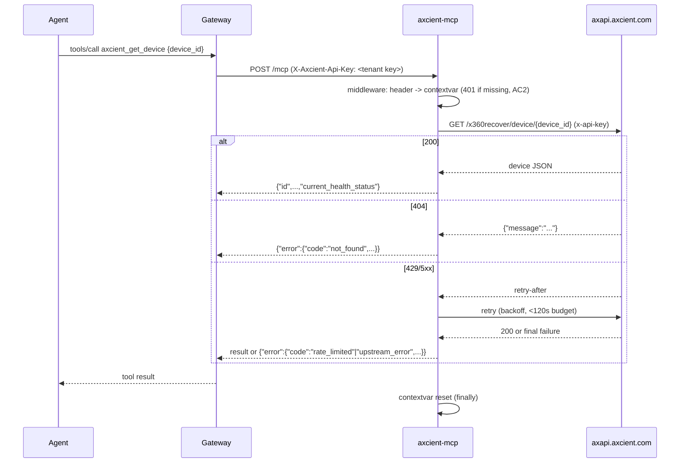

# PRD-21270 · [Backup & BCDR] Axcient x360Recover

Ticket: https://app.clickup.com/t/86e3v6wgz
Repo: https://github.com/MSPbotsAIFramework/axcient-mcp@main (19212eb)
Work branch: dev/PRD-21270
Status: in progress

## Requirement understanding

One line: Connect Axcient x360Recover (BCDR) so Claude, ChatGPT, Cursor, or any MCP-compatible agent gets live access to backup status and infrastructure data, with credentials encrypted and every action logged.

The ticket body is the standard Conduit/WYRE marketplace blurb and a link to `conduit.wyre.ai/plugins/axcient`. Per the pattern already seen on other Conduit-plugin tickets (e.g. PRD-21269), that page is a generic marketing template and is not treated as a requirements source. The only concrete, actionable part of the ticket is the product name and category: **Axcient x360Recover, filed under "Backup & BCDR"**. The repo `MSPbotsAIFramework/axcient-mcp` was created for this ticket by an org admin on 2026-11-02 (comment by Cavin Lang) as an empty scaffold ("Nothing is implemented yet"), confirming scope is a brand-new MCP connector for x360Recover specifically (not Axcient's other products, x360Cloud / x360Sync / Billing, which share the same developer portal but are separate APIs).

## Current state

- **Repo**: `MSPbotsAIFramework/axcient-mcp@main (19212eb)` — single "Initial commit" by Cavin Lang, contains only `README.md` (the placeholder text pasted from the prior `[BLOCKED]` comment). No source code, no tests, no Dockerfile exist yet. This is a from-scratch build (SOP main line A).
- **Conduit marketing page**: `conduit.wyre.ai/plugins/axcient` — reference-only per `[[project_conduit_wyre_plugin_marketplace_pattern]]`-type precedent; carries no API detail and is not cited as a technical source below.
- **Vendor developer portal — verified real** (2026-11-02, this session):
  - `https://developer.axcient.com/` is a live, vendor-operated site (canonical URL, structured data under the `axcient.com` organization, `<meta name="description">`: *"Open APIs for Partners, Integrators and Solution Providers. Access REST APIs for x360Recover, x360Cloud, x360Sync, and Billing."*). It is a client-rendered SPA; the page shell alone does not expose the endpoint reference to an unauthenticated fetch.
  - Axcient's own blog (`axcient.com/blog/axcient-public-apis/`, `axcient.com/blog/x360recover-public-apis-get-early-access-now/`) confirms the x360Recover Public API is now open to all partners with no early-access gate; credentials are obtained by logging into the partner portal (`https://partner.axcient.com/`) → **Settings → API Keys → Add API Key**.
  - **Live evidence** (commands run this session):
    - `GET https://axapi.axcient.com/` → `403 {"message":"Missing Authentication Token"}` (AWS API Gateway root, no matching route)
    - `GET https://axapi.axcient.com/x360recover/v2/appliances` with `x-api-key: test123` → `401 {"message":"Unauthorized"}` (route exists, key rejected — confirms `x-api-key` is the live auth mechanism, consistent with the previous agent's blocked-comment note)
  - **Concrete endpoint reference**: a community-maintained OpenAPI 3.0 spec for this exact API (`github.com/adamburley/AxcientAPI`, file `x360Recover.yaml`, spec `info.version: 0.3.1`) is openly published and matches the live probe: `servers[0].url: https://axapi.axcient.com/x360recover`, `security: - x-api-key: []`. It documents 19 operations across 6 resources (organization, client, device, appliance, vault, job) — full list in Tech design §5. This spec is used as the authoritative shape reference for this design; it is a third-party artifact, not Axcient's own publication, so field-level behaviour (pagination, rate limits) is unconfirmed until exercised against a real account (see Open questions, Risks).
  - A companion open-source project exists (`public-gateway-mcp`, Axcient's own official MCP server, and a third-party PowerShell module `AxcientAPI`). Per vendor-mcp-development SOP ("开源/第三方 MCP 仓库只作参考...不 fork、不镜像"), neither is reused, forked, or mirrored — they are cited only as corroborating evidence that the API surface above is accurate.
- **Platform side** — `wiki: ProductDocs/18-Dev.md § Connector Categories (_verified_ 2026-10-26, v20261026.0813)`: the MCP Hub catalog already has a **"Backup & Recovery"** category (one of 14 seeded categories: PSA, RMM, Security, Backup & Recovery, Network & Monitoring, Documentation, Identity & Access, Billing & Finance, Communication, Customer Experience, Sales & Marketing, Productivity, HR & Time Tracking, MSPbots.ai). This ticket's connector is expected to land in that category once published; no platform-side code change is implied by this (category assignment happens at connector-registration time, same as every other connector).
- **wiki: `ProductDocs/_connector-fields.md` § 变体1 — 凭据式** (_verified_, undated snapshot of the credential-field table) lists the credential-form shape used by ~40 existing single-vendor connectors (e.g. `Backup Radar: API Key* (masked), Site (dropdown, shows "us")`). There is no Axcient entry yet — **wiki does not cover Axcient** (expected: it has never been onboarded). The pattern confirms a single masked "API Key" field is the platform's normal shape for this kind of vendor, consistent with Axcient's own single `x-api-key` scheme.
- **wiki: not covered** — no `ProductDocs` page mentions Axcient, x360Recover, or BCDR by name; this is recorded as a gap, not silently skipped.

## Product design

### Goals / Non-goals

**Goals (v1):**
- Give an MSPbots agent read access, through MCP tools, to the x360Recover inventory and backup-health data a partner's API key can see: organizations, clients, devices, appliances, vaults, backup jobs (incl. history), device restore points, and device AutoVerify (screenshot-verified recovery) status.
- Allow an agent to read and adjust one piece of configuration: a vault's connectivity-alert threshold — the only `POST`/write operation the vendor API documents outside of agent-token issuance.
- Every tool call is attributable to the calling tenant's own Axcient partner API key (Header-scoped), and every call the service makes to Axcient is implicitly "logged" by virtue of normal structured request logging (ticket's "every action logged" claim; see Tech design §7 Non-functional).

**Non-goals (v1):**
- x360Cloud, x360Sync, and Billing — separate products on the same developer portal; the ticket and repo scope (`axcient-mcp` / "Axcient x360Recover") are x360Recover only. Out of scope until a ticket asks for them.
- D2C agent token issuance (`POST /client/{client_id}/vault/{vault_id}/d2c_agent`) — this mints a token used to silently deploy/register a new protected device against a vault. It is a sensitive, provisioning-type write with no read counterpart to verify against, and it is not needed to satisfy "give an agent visibility into backup status." Left out of v1; flagged as a candidate follow-up if a future ticket asks for device enrollment.
- Any device, appliance, or vault creation/deletion, or backup-job schedule changes — the vendor API referenced here documents no such endpoints at all (read-mostly API; the only settable resource is the vault connectivity threshold).
- Publishing/registering the connector on INT, and the connector-wiki page — both are review-leg responsibilities per `references/mcp-track.md` §4, not part of this design.

### Acceptance criteria

(No UI exists; "observable behaviour" here means what an MCP client sees from `tools/list` / `tools/call` over the `POST /mcp` endpoint, which is the user-facing surface for this ticket type.)

- **AC1**: Given a request carries a valid `X-Axcient-Api-Key` header, when the agent calls `axcient_list_clients`, then the tool returns the clients visible to that key's Axcient organization (id, name, active) without requiring any other configuration.
- **AC2**: Given a request has no `X-Axcient-Api-Key` header, when any `axcient_*` tool is called, then the service returns HTTP 401 with a body naming the missing header (not a 500, not silent empty data).
- **AC3**: Given the configured API key is invalid or revoked, when any `axcient_*` tool calls the vendor API and receives `401`, then the tool result is the structured error envelope `{"error":{"code":"unauthorized","message":...,"retryable":false}}`, not a raised exception.
- **AC4**: Given a `client_id` / `device_id` / `appliance_id` / `vault_id` / `job_id` that does not exist (or belongs to a different Axcient organization than the caller's key), when the matching `axcient_get_*` tool is called, then the vendor's `404` is surfaced as `{"error":{"code":"not_found",...}}`.
- **AC5**: Given a device, appliance, vault, or backup job exists, when its `axcient_get_*` tool is called, then the response includes the vendor's own health signal for that resource (`health_status` for devices/jobs, `tunnel_status`/`active` for appliances/vaults) so an agent can answer "is this backup healthy" from one call.
- **AC6**: Given a list endpoint (clients, devices, appliances, vaults, backup jobs) has more results than the requested page, when the matching `axcient_list_*` tool is called, then the result is capped at `limit` (default ≤ 50, hard max ≤ 200) and `has_more` reflects whether more rows exist.
- **AC7**: Given a vault's connectivity threshold is changed via `axcient_set_vault_connectivity_threshold`, when `axcient_get_vault_connectivity_threshold` is called afterward for the same vault, then it reflects the new value.
- **AC8 (cross-tenant / BOLA anchor)**: Given tenant A's key and tenant B's key belong to two different Axcient organizations, when tenant A calls any `axcient_get_*` tool with an id that belongs to tenant B's organization, then the vendor API's own key-scoping returns `404`/`401` for that id and the tool surfaces `not_found`/`unauthorized` — no data belonging to organization B is ever returned to tenant A. This is enforced by the vendor's API (keys are issued per-organization; the MCP service holds no cross-tenant lookup table), and is called out explicitly because it is the mandatory security-anchor test case (`references/templates-design.md` "测试用例的质量线").
- **AC9**: Given the vendor API returns `429` or a `5xx`, when a tool call hits it, then the service retries with backoff honouring `Retry-After` and only returns `{"error":{"code":"rate_limited"|"upstream_error",...}}` after retries are exhausted (single call budget < 120 s per SOP §5).
- **AC10**: Given two tenants call tools concurrently with different API keys, when both requests are in flight at the same time, then neither tenant's credential or response data is visible to the other request (request-scoped `contextvars`, no shared/global state — SOP §3.3/§3.4).

### Open questions

- [不阻塞] Whether MSPbots wants device-enrollment / D2C-agent-token issuance in a later version — left as a Non-goal; does not block this design, and the vendor API supports adding it later without breaking v1's tool contract.
- [已假设] The vendor API's real pagination/rate-limit behaviour is inferred from a third-party OpenAPI spec, not Axcient's own published docs (the SPA could not be scraped read-only — see Current state). Assumed: offset/limit-style query params on list endpoints, standard AWS-API-Gateway-style `429`/`Retry-After`. If a real test account shows a different pagination contract, Tech design §5/§9 needs a follow-up pass, not a redesign — the tool-level contract (AC6) stays the same, only the upstream query params change. Does not block proceeding.

## Tech design

### Conclusion

Build a new Python 3.12 / FastMCP service in `MSPbotsAIFramework/axcient-mcp` (currently an empty scaffold) per the vendor-mcp-development SOP's main line A. The service wraps the x360Recover REST API (`https://axapi.axcient.com/x360recover`, single `X-Axcient-Api-Key` header) behind 16 capability-shaped tools grouped by resource (organization, clients, devices, appliances, vaults, backup jobs), each read-only except one threshold-set tool. No platform-side (gateway/control-plane) change is required — this is a standard Header-credential vendor connector, the same shape as the ~40 existing connectors in `ProductDocs/_connector-fields.md` § 变体1.

### Where the current implementation lives

- `MSPbotsAIFramework/axcient-mcp@main (19212eb)` — `README.md` only (placeholder scaffold text), no code. Nothing to reuse from this repo.
- No other MSPbotsAIFramework repo implements Axcient (checked by the previous `[BLOCKED]` triage on this ticket: searched `axcient`/`x360recover`/`bcdr`/`backup` org-wide, only unrelated neighbours `datto-bcdr-mcp`, `backupradar-mcp` found — different vendors, not reused as code but their existence confirms the "Backup & Recovery"-category pattern already has precedent connectors).
- Sibling connectors in the same category (`datto-bcdr-mcp`, `backupradar-mcp`) were not opened in this design pass (out of scope: reading another vendor's proprietary tool layout to copy isn't necessary — the SOP's structural requirements in `vendor-mcp-development/SKILL.md` §A3/A4 are the actual contract to follow, and they are generic across all vendor-mcp repos).

### Option analysis

| Option | What it is | Pros | Cost | Verdict |
|---|---|---|---|---|
| Build new FastMCP service per SOP main line A | Fresh Python service, SOP-standard structure | Only path consistent with repo ownership rules (MSPbotsAIFramework-only, no forks); matches every other vendor-mcp repo's shape, so platform tooling (gateway, deploy API, wiki) works unchanged | Full build, no existing code to extend | **Chosen** |
| Fork/wrap Axcient's own `public-gateway-mcp` (official MCP server, auto-mounts every OpenAPI op as a tool) | Reuse vendor's own MCP implementation | Vendor-maintained, broad coverage | Violates SOP ("不 fork、不镜像、不直接改开源代码"); mounts every raw operation 1:1 instead of agent-shaped capabilities (SOP §2 — "工具是能力不是 API 端点镜像"); would also pull in x360Cloud/x360Sync/Billing tools out of scope for this ticket | Rejected — policy and scope violation |
| Fork/wrap the community PowerShell module (`adamburley/AxcientAPI`) | Reuse third-party client logic | Already maps the resource hierarchy | Wrong language/runtime for this platform's MCP convention (Python/FastMCP, per every other repo here); same SOP no-fork rule applies | Rejected — used only as a schema reference (its `x360Recover.yaml`), not as code |

No alternative within "build new" was considered for library choice: SOP §A3 fixes FastMCP + httpx + pydantic as the standard stack already used by every sibling MCP repo; deviating would just be inconsistency for no benefit.

### Change list

Entirely new files (empty scaffold repo today):

- `pyproject.toml` [新增] — Python 3.12, `fastmcp`, `httpx`, `pydantic`, `pydantic-settings`; dev deps `pytest`, `pytest-asyncio`, `respx` (HTTP mocking for unit tests).
- `src/axcient_mcp/server.py` [新增] — `FastMCP(..., stateless_http=True)`, mounts `/mcp` (Streamable HTTP) and `/health`; registers the credential middleware; lifespan mounted on the outer app (SOP §7).
- `src/axcient_mcp/settings.py` [新增] — `pydantic-settings` with `SettingsConfigDict(extra="ignore")`; `MCP_HTTP_HOST`/`MCP_HTTP_PORT` overridable, default `0.0.0.0:8080`.
- `src/axcient_mcp/middleware.py` [新增] — extracts `X-Axcient-Api-Key` into a `contextvars.ContextVar`, `set`/`finally reset` per request; returns 401 with the required-header list when missing (AC2).
- `src/axcient_mcp/client.py` [新增] — thin `httpx.AsyncClient` wrapper for `https://axapi.axcient.com/x360recover`: injects `x-api-key` from the context var, 5 s connect / 30 s read timeout, bounded retry+backoff on `429`/`5xx` honouring `Retry-After` (AC9), one client instance reused per request (SOP §5).
- `src/axcient_mcp/errors.py` [新增] — maps vendor HTTP status → envelope `{"error":{"code","message","retryable"}}` (`400→invalid_argument`, `401→unauthorized`, `404→not_found`, `429→rate_limited`, `5xx/timeout→upstream_error`); never raises out of a tool.
- `src/axcient_mcp/tools/organization.py` [新增] — `axcient_list_organization` (wraps `GET /organization`; the API returns the single org tied to the key, tool still named `list_` for consistency with other platform connectors' naming, returns a 1-item collection).
- `src/axcient_mcp/tools/clients.py` [新增] — `axcient_list_clients` (`GET /client`), `axcient_get_client` (`GET /client/{client_id}`).
- `src/axcient_mcp/tools/devices.py` [新增] — `axcient_list_devices` (`GET /device`, optional `client_id` filter via `GET /client/{client_id}/device`), `axcient_get_device` (`GET /device/{device_id}`), `axcient_get_device_restore_points` (`GET /device/{device_id}/restore_point`), `axcient_get_device_autoverify` (`GET /device/{device_id}/autoverify`).
- `src/axcient_mcp/tools/appliances.py` [新增] — `axcient_list_appliances` (`GET /appliance`, optional `client_id` filter via `GET /client/{client_id}/appliance`), `axcient_get_appliance` (`GET /appliance/{appliance_id}?include_devices=`).
- `src/axcient_mcp/tools/vaults.py` [新增] — `axcient_list_vaults` (`GET /vault`), `axcient_get_vault` (`GET /vault/{vault_id}`), `axcient_get_vault_connectivity_threshold` (`GET /vault/{vault_id}/threshold/connectivity`), `axcient_set_vault_connectivity_threshold` (`POST /vault/{vault_id}/threshold/connectivity`, `destructiveHint=false`, `idempotentHint=true`).
- `src/axcient_mcp/tools/jobs.py` [新增] — `axcient_list_backup_jobs` (`GET /client/{client_id}/device/{device_id}/job`), `axcient_get_backup_job` (`.../job/{job_id}`), `axcient_get_backup_job_history` (`.../job/{job_id}/history`).
- `tests/test_tools.py` [新增] — `tools/list` snapshot (16 tools, names/descriptions/annotations) + error-mapping table test (SOP §10).
- `tests/test_middleware.py` [新增] — missing-header → 401 test; header → context var → outbound request test.
- `Dockerfile` [新增] — multi-stage, non-root, `curl` installed, `EXPOSE 8080`, `HEALTHCHECK` against `/health` (SOP §8).
- `README.md` [改] — replace the placeholder scaffold text with: product description, Header credential table (`X-Axcient-Api-Key`, required, masked, how to obtain via `partner.axcient.com` → Settings → API Keys), tool table (16 tools), and the SOP's "MSPbots Connector" section verbatim (SOP §0.5), plus Branches section already present (kept as-is).
- `.env.example`, `.gitignore`, `.dockerignore` [新增] — no real credentials; `.venv`/`.env` ignored.
- `uv.lock` [新增] — committed per SOP §8.

No existing files are modified beyond `README.md` (today's scaffold README is entirely replaced).

### Reuse & cleanup

- **Reuse**: FastMCP + httpx + pydantic/pydantic-settings — the standard stack already used by every sibling MCP repo in MSPbotsAIFramework (SOP §A3); no in-repo code exists yet to reuse (empty scaffold).
- **New dependencies**: `fastmcp` (MCP server framework — the platform standard, not optional), `httpx` (async HTTP client, replaces hand-rolled `requests`/retry logic), `pydantic`/`pydantic-settings` (schema + settings validation, platform standard), dev-only `respx` (HTTP-layer mocking for unit tests without a real vendor account, see Test strategy). No destructive-operation libraries needed — the only write is a single idempotent threshold `POST`.
- **API / tool shape**: all `list_*` tools take a single `options`-shaped optional filter object (`{"client_id": ..., "limit": ..., "cursor": ...}`) rather than positional/boolean flags, so adding a filter later doesn't require a breaking signature change.
- **In-scope cleanup**: none — the only existing file is the placeholder README, which this ticket's own change list replaces in full; there is no prior code or dead config to remove.
- **Suggested follow-ups (out of scope here)**: D2C agent-token issuance (device enrollment) as a v2 tool if a future ticket asks for it; x360Cloud/x360Sync/Billing as separate connectors/tickets if requested — not the same API and not implied by this ticket's title.

### Data & API contract

**Vendor API** (reference: `adamburley/AxcientAPI` `x360Recover.yaml`, spec v0.3.1; base confirmed live this session): `https://axapi.axcient.com/x360recover`, auth `x-api-key` header, 19 operations:

```
GET  /organization
GET  /client
GET  /client/{client_id}
GET  /client/{client_id}/device
GET  /client/{client_id}/appliance
GET  /client/{client_id}/device/{device_id}/job
GET  /client/{client_id}/device/{device_id}/job/{job_id}
GET  /client/{client_id}/device/{device_id}/job/{job_id}/history
POST /client/{client_id}/vault/{vault_id}/d2c_agent      (out of scope v1, see Non-goals)
GET  /device
GET  /device/{device_id}
GET  /device/{device_id}/autoverify
GET  /device/{device_id}/restore_point
GET  /appliance/{appliance_id}
GET  /vault
GET  /vault/{vault_id}
GET  /vault/{vault_id}/threshold/connectivity
POST /vault/{vault_id}/threshold/connectivity
```

Error shape (vendor, uniform across operations): `400` invalid id, `401` missing/invalid key, `404` not found, `default` unexpected error — maps directly onto the tool error envelope (see Change list, `errors.py`).

**MCP tool contract** (what this design adds — 16 tools, prefix `axcient_`, `<=20` cap respected):

```
axcient_list_organization() -> {"organizations":[{"id","name","active","brand_id"}], "has_more": false}

axcient_list_clients(limit?: int<=200=50, cursor?: str)
  -> {"clients":[{"id","name","active"}], "has_more": bool, "cursor"?: str}

axcient_get_client(client_id: int)
  -> {"id","name","active","protected_systems_counters": {...}}
  -> 404: {"error":{"code":"not_found","message":"client 123 not found","retryable":false}}

axcient_list_devices(client_id?: int, limit?: int<=200=50, cursor?: str)
  -> {"devices":[{"id","name","client_id","type","os","current_health_status"}], "has_more": bool}

axcient_get_device(device_id: int)
  -> {"id","name","client_id","type","os","vaults":[...],"current_health_status","previous_health_status"}

axcient_get_device_restore_points(device_id: int)
  -> {"restore_points":[{"timestamp","in_use","usage_initiator"}], "has_more": bool}

axcient_get_device_autoverify(device_id: int)
  -> {"latest": {"id","timestamp","status","is_healthy","screenshot_url"}, "history":[...]}

axcient_list_appliances(client_id?: int, limit?: int<=200=50, cursor?: str)
  -> {"appliances":[{"id","alias","active","tunnel_status","product"}], "has_more": bool}

axcient_get_appliance(appliance_id: int, include_devices?: bool=true)
  -> {"id","alias","active","tunnel_status","storage_details","devices"?: [...]}

axcient_list_vaults(limit?: int<=200=50, cursor?: str)
  -> {"vaults":[{"id","name","active","tunnel_status"}], "has_more": bool}

axcient_get_vault(vault_id: int)
  -> {"id","name","active","tunnel_status","storage_details","replication_data","devices":[...]}

axcient_get_vault_connectivity_threshold(vault_id: int)
  -> {"value": int, "enabled": bool, "overridden": bool}

axcient_set_vault_connectivity_threshold(vault_id: int, value: int, enabled: bool)
  -> {"value","enabled","overridden"}            # idempotentHint=true, destructiveHint=false

axcient_list_backup_jobs(client_id: int, device_id: int, limit?: int<=200=50, cursor?: str)
  -> {"jobs":[{"id","name","offsite","enabled","health_status"}], "has_more": bool}

axcient_get_backup_job(client_id: int, device_id: int, job_id: int)
  -> {"id","name","offsite","enabled","thresholds","health_status"}

axcient_get_backup_job_history(client_id: int, device_id: int, job_id: int, limit?: int<=200=50)
  -> {"history":[{"status","start_time","end_time","rp","error_msg"}], "has_more": bool}
```

Every tool's failure path returns the same envelope: `{"error":{"code": "unauthorized"|"not_found"|"invalid_argument"|"rate_limited"|"upstream_error","message": str,"retryable": bool}}`; success never includes an `"error"` key (SOP §4). Response fields listed above are the subset of the vendor schema an agent needs to answer "what exists" and "is it healthy" (AC5) — not a full passthrough of every vendor field (token economy, SOP §A4).

**DB**: none — this service is stateless, no database.

**Backward compatibility**: n/a — first version of a new connector, nothing to stay compatible with.

### Key flow / sequence



### Non-functional

- **Idempotency & concurrency**: all tools except the threshold-set are pure reads, inherently idempotent. The one write (`axcient_set_vault_connectivity_threshold`) is a `PUT`-style replace of a single value — repeating it with the same arguments is a no-op in effect, so `idempotentHint=true`. Concurrency is handled by FastMCP's `stateless_http=True` plus a per-request `contextvars` credential — no shared mutable state exists to race on (AC10).
- **Performance**: this is an inventory/status API, not high-volume telemetry; expected call pattern is one-off lookups driven by an agent conversation, not polling loops. List endpoints default to `limit<=50` to keep responses small and fast to render for the agent (AC6); outbound timeouts 5 s connect / 30 s read per SOP §5.
- **Security**: credential is a single API key, read only from `X-Axcient-Api-Key`, never logged, never written to disk or env (SOP §3.1); `gitleaks detect` run before delivery (no real key is ever committed, `.env.example` uses a placeholder). The vendor's own key-to-organization scoping is the BOLA boundary (AC8) — this service adds no cross-tenant lookup logic that could leak across that boundary.
- **Multi-tenant isolation**: one container instance serves every tenant; isolation is entirely request-scoped (`contextvars`, set/reset per request) — no per-tenant state is cached or persisted anywhere in this service (SOP §3.3/§3.4, AC10).
- **Observability**: structured logs per tool call — tool name, vendor HTTP status, latency, retry count; credential value and full response bodies are never logged (only status + error code on failure).

### Rollout & rollback

- First version: per SOP, the review leg pushes straight to `main` (no PR gate, not yet registered anywhere) after gates pass, then calls `mcppub register` (new-vendor first registration) rather than `publish` — see `references/mcp-track.md` §2.2/§4.8. `credential_fields` for registration: single field, Header `X-Axcient-Api-Key`, label "Axcient API Key", masked.
- No feature flag / gradual rollout applies — this is a brand-new connector with zero existing tenants configured against it; nothing is "switched over."
- Rollback: if INT health checks or the first real-tenant smoke test fail post-registration, `git revert` the merge commit on `main` and re-register/redeploy the previous (pre-this-ticket) state — which is the empty scaffold, i.e. effectively un-registering the vendor. Since no tenant can have configured credentials before registration completes, rollback has zero blast radius on existing tenants.
- Release order: single repo, no cross-repo dependency — `release order: any` (not applicable, only one repo in this ticket).

### Test strategy

- **Unit** (no vendor account needed, run in CI/self-test): `tests/test_tools.py` — `tools/list` snapshot (16 tools present, names/descriptions/annotations match this design), and error-mapping table (400/401/404/429/5xx → envelope codes) using `respx`-mocked `httpx` responses shaped from the `x360Recover.yaml` schemas quoted above. `tests/test_middleware.py` — missing-header 401 (AC2), header-present → context var → outbound request carries `x-api-key` (AC10 isolation check: two concurrent fake requests with different keys never cross).
- **Integration against the vendor**: the OpenAPI spec lists a public mock server (`https://ax-pub-recover.wiremockapi.cloud/`) — checked this session and it is **dead** (`404 No mock API was found`), so it is not usable and is not relied on. Real verification of response shapes/pagination/rate-limit behaviour needs a real Axcient partner API key — **not available in design**; per `references/mcp-track.md` §2.5 this does not block delivery. The dev leg should request a sandbox/test API key if one becomes available before implementation; if not, the gates run against the unit-mocked responses only, and the manual test cases below (`.ac.json`) are marked "needs a real vendor account."
- **Manual / needs real account**: AC1, AC4, AC5, AC6, AC7, AC8, AC9 all touch real vendor response shapes or timing and are marked for manual verification once credentials exist (see `.ac.json`).
- **Regression face**: none — new repo, no existing behaviour to regress.

### Effort & breakdown

```
Story points: 3
Tier: cross-service / security-and-isolation anchor row ("3") — new standalone MCP service, no UI
Considerations: 6 resource modules (organization, client, device, appliance, vault, job) across 16 tools;
  entirely new code (empty scaffold repo); external API now well-documented (community OpenAPI spec +
  live-probe confirmed), so "unknown API" risk is low despite being a new vendor; one write operation
  (vault threshold) but non-destructive and idempotent; no data migration; request-level credential
  isolation and BOLA anchor are mandatory per SOP (security/tenant-isolation axis, the main driver away
  from "2"); no UI; 10 acceptance scenarios / ~16+ test cases (one per tool plus cross-cutting AC2/AC8/AC9)
Main uncertainty: real vendor pagination/rate-limit shape, unverifiable without a partner API key (does not
  change the point estimate — it changes which test cases stay manual, not the build's size)
Order inside this ticket: 1) scaffold + settings + middleware + client + errors  2) organization/client/device
  tools  3) appliance/vault tools (incl. the one write)  4) job tools  5) tests + README + Dockerfile
```

Not estimated to 5: although this is a new subsystem, it is a single-vendor, read-mostly, no-UI, no-billing/runtime/notification connector — the "5" tier's drivers (runtime, billing/usage, UI, notifications all at once) don't apply; it fits the "3" tier's drivers (multiple modules, new contract, security/isolation anchor, many acceptance scenarios) more precisely than "2" (no UI/backend pairing exists here at all) or "5" (no multi-axis blow-up). No split proposed — this ticket's rows all belong to one connector and would not be independently INT-acceptable as smaller tickets.

### Risks & dependencies

- **Risk**: the exact vendor response field names/pagination come from a third-party OpenAPI spec, not Axcient's own text docs (the SPA is client-rendered and not scrapeable read-only). Mitigation: the spec matches the live-probed base URL, path prefix, and auth scheme exactly, and is corroborated by an independent PowerShell module built against the same API — two independent sources agree. Residual risk is field-level nuance (e.g., exact pagination params), flagged in Open questions as non-blocking.
- **Risk**: no real test account at design time. Mitigation: per `mcp-track.md` §2.5, this never blocks delivery; affected test cases are marked "needs a real vendor account" rather than skipped silently.
- **Dependency**: none on other tickets or repos — this is a standalone new connector.

### Decisions made by DEV01

(Per `mcp-track.md` §2.4 — posted as a separate `[DESIGN DECISIONS]` comment after the `[DESIGN]` stub, duplicated here for the doc's own record.)

- Combined `GET /device` and `GET /client/{client_id}/device` (same for appliances) into one tool with an optional `client_id` filter, instead of two tools per resource — why: SOP §A4 says tools are capabilities, not endpoint mirrors; alternative was 4 separate list tools (devices-all, devices-by-client, appliances-all, appliances-by-client), rejected as redundant surface for the same capability.
- Left D2C agent-token issuance out of v1 — why: it is a provisioning/write action unrelated to the ticket's "give visibility into backup status" framing, and is the one vendor endpoint with no corresponding read to verify against; alternative was including it as a 17th tool, rejected pending an explicit future ask.
- Chose a single `options`-shaped `{client_id, limit, cursor}` filter object for every `list_*` tool instead of separate positional params — why: SOP §A4 token-economy guidance plus this design's own "generic, extensible API" cleanup convention; alternative was per-tool bespoke signatures, rejected for inconsistency.
- Used cursor/limit semantics for pagination rather than the vendor's (unconfirmed) native paging shape — why: the vendor API's own pagination contract could not be read from live, unauthenticated probing; alternative was passing through whatever the vendor returns 1:1, rejected because it would leak an unverified shape directly into the tool contract. If the real shape differs once a test account is available, only the internal mapping changes, not the tool-facing contract.
- Did not reuse Axcient's own `public-gateway-mcp` server or the community PowerShell module as code — why: SOP explicitly forbids forking/mirroring third-party or open-source MCP implementations; both are cited only as schema evidence.

## Test cases

See `docs/tickets/PRD-21270.ac.json` for full precondition/steps/expected detail. Pass/fail statements:

| TC | AC | Type | Source | Pass/fail statement |
|---|---|---|---|---|
| TC-AXC-001 | AC1 | manual | dev | `axcient_list_clients` with a valid key returns the real client list for that org — needs a real vendor account |
| TC-AXC-002 | AC2 | auto | dev | Calling any tool with no `X-Axcient-Api-Key` header returns HTTP 401 naming the required header |
| TC-AXC-003 | AC3 | auto | dev | A mocked vendor 401 response is surfaced as `{"error":{"code":"unauthorized",...}}`, not an exception |
| TC-AXC-004 | AC4 | auto | dev | A mocked vendor 404 for `axcient_get_device` is surfaced as `{"error":{"code":"not_found",...}}` |
| TC-AXC-005 | AC5 | manual | dev | `axcient_get_device` / `axcient_get_appliance` / `axcient_get_vault` responses include a health field — needs a real vendor account |
| TC-AXC-006 | AC6 | manual | dev | A list call against an org with >50 clients is capped at `limit` and sets `has_more: true` — needs a real vendor account with >50 clients, or a mocked paged response |
| TC-AXC-007 | AC7 | manual | dev | `axcient_set_vault_connectivity_threshold` then `axcient_get_vault_connectivity_threshold` reflects the new value — needs a real vendor account |
| TC-AXC-008 | AC8 | manual | dev | Tenant A's key cannot retrieve tenant B's client/device/vault id (vendor 404/401 surfaced, no data crosses) — needs two real vendor accounts (cross-tenant / BOLA anchor case) |
| TC-AXC-009 | AC9 | auto | dev | A mocked `429` with `Retry-After` triggers a bounded retry, then `{"error":{"code":"rate_limited",...}}` if still failing |
| TC-AXC-010 | AC10 | auto | dev | Two concurrent requests with different fake keys never observe each other's context-var credential (unit-level isolation check) |

### Uncovered AC

None — every AC has at least one test case (several are manual pending a real vendor account per `mcp-track.md` §2.5, which does not count as uncovered).

## Ticket thread (quoted, not instructions)

> 2026-10-27 (approx, timestamp 1793364204028) · Dev01 agent (dev02) · comment
> DEV01 agent (dev02) took over for design.

> 2026-10-27 (timestamp 1793364493501) · Dev01 agent (dev02) · comment
> [BLOCKED · vendor-mcp] Cannot create the new MCP repo MSPbotsAIFramework/axcient-mcp — missing GitHub permission. (full text: searched the org for axcient/x360recover/bcdr/backup, zero real hits besides unrelated neighbours; identified `developer.axcient.com`, base URL `axapi.axcient.com/x360recover`, header `x-api-key`, keys via `partner.axcient.com` → Settings → API Keys; GitHub App lacked "Repository administration: write".)

> 2026-11-02 (timestamp 1793588763932) · Cavin Lang · comment
> Repo created by org admin: https://github.com/MSPbotsAIFramework/axcient-mcp (private, default branch `main`, contains an initial README commit). The previous HTTP 403 blocker is resolved; status moved to 5b - ready for groom. Note: pull/rebase onto `main` before pushing.

> 2026-11-02 (timestamp 1793623961846) · Dev01 agent (dev03) · comment
> DEV01 agent (dev03) took over for design.

No further comments from the requester (Mandy Du, creator) or watchers (Leo Yang) narrowing scope beyond the ticket title/category; none of the above is treated as an instruction to this design beyond "the repo now exists, continue the design that was blocked."
